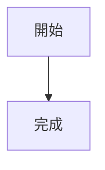

# Mermaid 圖表

文章與頁面可使用 Mermaid 語法撰寫圖表。內容只保存程式碼區塊原文，瀏覽器載入頁面時以自帶的 Pele 產生 SVG；不需要外掛，也不會向外部網址載入繪圖資源。

## 撰寫方式

在 Markdown 中以 `mermaid` 標記程式碼區塊：



Pele 以 Mermaid 12.1.0 語法為目標，支援流程圖、循序圖、類別圖、狀態圖、ER 圖、圓餅圖、甘特圖、Git 圖、心智圖、時間軸、旅程圖、XY 圖、象限圖、需求圖、C4、桑基圖、區塊圖、封包圖、看板、架構圖、雷達圖、樹狀圖及其他圖種。排版與部分樣式由 Pele 負責，與 Mermaid 原版可能不同。

單張圖原文上限為 50,000 個 JavaScript 字元。超過上限或語法不支援時，頁面保留原文並顯示繁中或英文錯誤提示；同頁其他圖仍會照常處理。圖表不可載入外部圖片，圖表中的連結只允許 `http`、`https`、`mailto` 與站內相對路徑。

## 預覽與匯出

編輯器的「分割」與「預覽」會隨原稿更新圖表；儲存並重新開啟後仍可修改相同語法。繪圖元件載入失敗時保留原文，恢復連線後再次編輯即可重試。

匯出 Jelly Markdown 或純 Markdown 時保留 Mermaid 圍欄。HTML 匯出會內嵌繪圖程式與樣式，離線開啟也能畫圖；選擇 PDF 時會先完成繪圖再開啟列印，過寬圖表會完整縮至紙張寬度。

## 主題整合

主題在共用版型 `<head>` 呼叫 `{{contentAssets .}}`。有 Mermaid 區塊時，函式會載入本機 Pele 與共用整合腳本，頁面載入後自動繪圖；沒有圖表時不會輸出這些腳本。新主題可直接使用 Pele 預設配色，也可定義 `--pele-bg`、`--pele-fg`、`--pele-muted`、`--pele-line`、`--pele-surface`、`--pele-surface-alt`、`--pele-border`、`--pele-accent`、`--pele-critical`、`--pele-error`、`--pele-font` 與 `--pele-radius` 等 CSS 變數配合主題。

編輯器預覽等動態內容可在完成插入預覽 DOM 後呼叫：

```js
await JellyMermaid.render(previewRoot);
```

`previewRoot` 可為 `Document` 或 `Element`。重複呼叫會保留原文未變的既有 SVG；原文改變會重繪，移除原始區塊也會清掉相應圖表。呼叫會等待可用的網頁字型完成載入，並以 Promise 在區塊處理完成後結束。

## 升級 Pele

執行 `scripts/vendor/pele.sh` 重新取得並驗證套件。腳本固定檢查 npm tarball integrity 與 Git 標籤 commit，並計算發布檔 SHA-256 寫入 `VERSION`。升級時先更新腳本開頭的版本、commit 與 integrity，再重建並檢查 `web/admin/assets/pele/VERSION`；每次發版也依 `docs/release-checklist.md` 更新自帶套件並重跑驗收。
